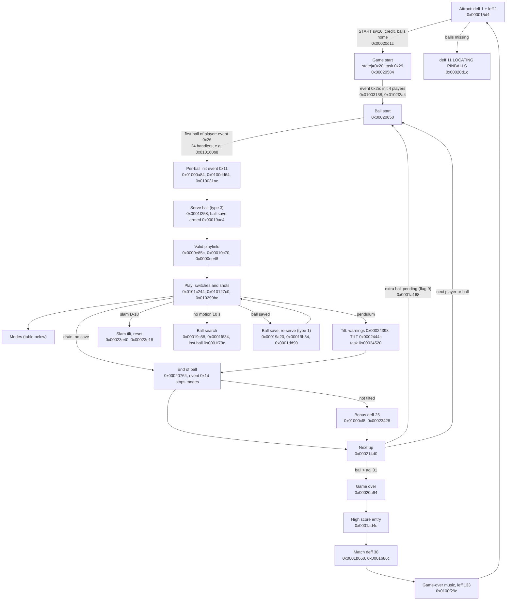

# Functional diagram (taken from the decompile, one ROM address per node)

Root diagram of the base game, Tron Legacy LE 1.74 (`trn_174h`). Every node carries the address of the
routine in `code/tron_game_decompiled_v2.c` (OS addresses below 0x36000, game code from 0x01000000). Sources:
`rules/modes/game_flow.md` sections 4 to 6 (each step cites its routine). The second level, one diagram per
mode, is the mode specs listed below; their entry routines are the nodes of the third table.
Status 2026-11-26: root level done, mode entries listed; per-mode node diagrams are still to be drawn from
the specs (open, see the end).

## Stop handlers of event 0x1d (end of ball), each ends one mode

End of Line MB flag 0x27 (0x010042d0), Disc MB 0x24 (0x01007074), Light Cycle MB 0x2b (0x01018804), Quorra MB 0x29
(0x0101cd7c), Portal MB 0x37 (0x0102f6c8), CLU hurry-up 0x01001c88, GEM 0x01013970, Sea of Simulation 0x01026784,
Zuse 0x01031664, mode objects 0x0100a244. [`game_flow.md` 6.1]

## Mode entries (nodes of level two; spec = `rules/modes/<file>`)

| Mode | Spec | Entry routines (ROM) |
|---|---|---|
| Attract and tournament pages | attract_and_service.md | 0x000015d4, 0x01034364, 0x01017dc4, 0x0100f29c |
| End-of-ball bonus | bonus.md | 0x01000cf8, 0x01000e7c, 0x01001374, 0x01000cb0 |
| CLU hurry-up | clu_hurryup.md | 0x01016b0c, 0x010167f4 |
| Combos | combos.md | 0x010031ac, 0x0100317c, 0x01003138 |
| End of Line (Daft Punk) MB | end_of_line_multiball.md, daft_punk_multiball.md | 0x010042d0, 0x01004238, 0x01004c68 |
| Disc MB | disc_multiball.md | 0x01007074, 0x010070b8, 0x0100769c, 0x0100781c |
| Find Flynn and items | find_flynn_and_items.md | 0x0100d698, 0x01016188, 0x0103129c |
| Flynn's Arcade | flynns_arcade.md | 0x0100df98, 0x0100dd38, 0x0100ddb0, 0x0100debc |
| GEM hurry-up | gem_hurryup.md | 0x010138f8, 0x010139b8, 0x01013c5c, 0x01013da8 |
| Light Cycle MB | light_cycle_multiball.md | 0x01018804, 0x0101b26c, 0x0102e8c0, 0x0102eaa4 |
| Portal MB | portal_multiball.md | 0x0102f6c8, 0x01000cd4, 0x0102f474 |
| Quorra MB | quorra_multiball.md | 0x0102e8c0, 0x0101cd7c, 0x0101f410, 0x0101f55c |
| Recognizer and Disc Battle | recognizer_and_disc_battle.md | 0x0101fd94, 0x010224ec, 0x010223c4, 0x010201e4 |
| Sea of Simulation | sea_of_simulation.md | 0x01026520, 0x01026794, 0x01026490 |
| Skill shots | skill_shots.md | 0x010290ec, 0x01029148 |
| Switches and shots | switches_and_shots.md | 0x0101c244, 0x010127c0, 0x010299bc, 0x0101c30c |
| TRON targets | tron_targets.md | 0x0100c558, 0x0100b294 |
| ZEN rollover | zen_rollover.md | 0x0103116c, 0x0103129c, 0x0102ac5c |
| ZUSE fast scoring | zuse_fast_scoring.md | 0x01031b88, 0x01033624, 0x01033680, 0x01033790 |

## Level two: one diagram per mode (`docs/flow/`)

Each file has a Mermaid diagram with a ROM address per node, taken from the mode's spec (`rules/modes/`).
`python tools/flow_check.py` checks that every cited ROM address is a function start (or inside a function
of the decompile): 0 address outside the decompile on 2026-11-26.

attract_and_service, bonus, clu_hurryup, combos, disc_multiball, end_of_line_multiball (with Daft Punk),
find_flynn_and_items, flynns_arcade, gem_hurryup, light_cycle_multiball, portal_multiball, quorra_multiball,
recognizer_and_disc_battle, sea_of_simulation, skill_shots, switches_and_shots, tron_targets, zen_rollover,
zuse_fast_scoring (19 files, one per entry of the table above).

## Open (with the reason)

- Addresses that point a few bytes into a function (prologue skipped by the spec) are accepted by the check
  and printed; they are not re-pointed to the function start.
- The diagrams follow the specs; a node whose behaviour was only seen in a trace is marked as such in its spec,
  not in the diagram.

## Check of every address (2026-11-26)

All 99 addresses of this page are the start of a function in `code/tron_game_decompiled_v2.c` (script check); names as the decompile has them:

| Address | Function name in the decompile |
|---|---|
| 0x000015d4 | `attract_start` |
| 0x0000e85c | `switch_dispatch_debounce` |
| 0x0000ee48 | `FUN_0000ee48` |
| 0x00010c70 | `switch_timeout_obj_add` |
| 0x00019a20 | `ball_save_task` |
| 0x00019ac4 | `ball_save_arm` |
| 0x00019b34 | `ball_save_try` |
| 0x00019c58 | `ball_search_tick` |
| 0x0001a168 | `eb_award` |
| 0x0001ad4c | `high_score_entry` |
| 0x0001b660 | `match` |
| 0x0001b86c | `match_award` |
| 0x0001dd90 | `trough_drain_check` |
| 0x0001f258 | `serve_ball` |
| 0x0001f634 | `FUN_0001f634` |
| 0x0001f79c | `ball_search_start` |
| 0x00020584 | `game_init` |
| 0x00020650 | `ball_start` |
| 0x00020764 | `end_of_ball` |
| 0x00020a64 | `game_over` |
| 0x00020d1c | `start_button` |
| 0x000214d0 | `next_up` |
| 0x00023428 | `score_add_player` |
| 0x00023e18 | `slam_reset_task` |
| 0x00023e40 | `slam_tilt` |
| 0x00024398 | `tilt_warning` |
| 0x0002444c | `tilt` |
| 0x00024520 | `task_2e` |
| 0x01000000 | `deff_010` |
| 0x01000a84 | `bonus_ball_reset_event_entry` |
| 0x01000cb0 | `bonus_sos_value` |
| 0x01000cd4 | `bonus_portal_value` |
| 0x01000cf8 | `bonus_total` |
| 0x01000e7c | `bonus_count_task` |
| 0x01001374 | `deff_025_bonus` |
| 0x01001c88 | `clu_on_end_of_ball` |
| 0x01003138 | `combo_game_start_reset` |
| 0x0100317c | `combo_first_ball_base` |
| 0x010031ac | `combo_ball_start_reset` |
| 0x01004238 | `eol_extra_ball_check` |
| 0x010042d0 | `eol_letters_ramp` |
| 0x01004c68 | `eol_multiball_can_start` |
| 0x01007074 | `adj68_disc_shots` |
| 0x010070b8 | `adj69_recognizer_shots` |
| 0x0100769c | `dmb_open_restart_window` |
| 0x0100781c | `dmb_restart_on_disc_hit` |
| 0x0100a244 | `FUN_0100a244` |
| 0x0100b294 | `tron_bank_setup` |
| 0x0100c558 | `tron_award_timer_task` |
| 0x0100d698 | `on_find_flynn_started` |
| 0x0100dd38 | `arcade_game_start_clear` |
| 0x0100dd64 | `arcade_ball_start_light` |
| 0x0100ddb0 | `arcade_set_lit` |
| 0x0100debc | `arcade_pick_and_award` |
| 0x0100df98 | `arcade_weight_500k` |
| 0x0100f29c | `game_over_music_task` |
| 0x010127c0 | `outlane_insult_speech` |
| 0x010138f8 | `gem_player_init` |
| 0x01013970 | `gem_on_end_of_ball` |
| 0x010139b8 | `gem_loops_to_start` |
| 0x01013c5c | `on_gem_hurryup_started` |
| 0x01013da8 | `on_gem_hurryup_awards` |
| 0x010160b8 | `items_player_reset` |
| 0x01016188 | `item_level_add` |
| 0x010167f4 | `clu_lanes_player_init` |
| 0x01016b0c | `clu_lane_hit` |
| 0x01017dc4 | `leff_001_attract` |
| 0x01018804 | `light_cycle_mb_shot` |
| 0x0101b26c | `lc_mb_start` |
| 0x0101c244 | `pop_hits_for_next_level` |
| 0x0101c30c | `pop_value_ball_reset` |
| 0x0101cd7c | `quorra_player_init` |
| 0x0101f410 | `quorra_progress_shot` |
| 0x0101f55c | `quorra_mb_start` |
| 0x0101fd94 | `recog_reset_player_at_game_start` |
| 0x010201e4 | `recog_target_hit` |
| 0x010223c4 | `FUN_010223c4` |
| 0x010224ec | `bank_motor_init` |
| 0x01026490 | `sos_stage_setup` |
| 0x01026520 | `sos_start` |
| 0x01026784 | `FUN_01026784` |
| 0x01026794 | `sos_tilt_pay_skip_bonuses` |
| 0x010290ec | `skill_counts_first_ball_reset` |
| 0x01029148 | `skill_on_serve` |
| 0x010299bc | `spinner_values_ball_start_reset` |
| 0x0102ac5c | `sw12_zen_rollover_handler` |
| 0x0102e8c0 | `vuk_lit_item_add` |
| 0x0102eaa4 | `vuk_lit_item_take` |
| 0x0102f2a4 | `portal_mb_game_reset` |
| 0x0102f474 | `portal_mb_start` |
| 0x0102f6c8 | `portal_mb_shot` |
| 0x0103116c | `zen_player_init` |
| 0x0103129c | `zen_award` |
| 0x01031664 | `zfs_on_end_of_ball` |
| 0x01031b88 | `zfs_score_hit` |
| 0x01033624 | `zuse_letters_reset` |
| 0x01033680 | `zuse_player_init` |
| 0x01033790 | `zuse_letter_hit` |
| 0x01034364 | `deff_001_attract_pages` |
